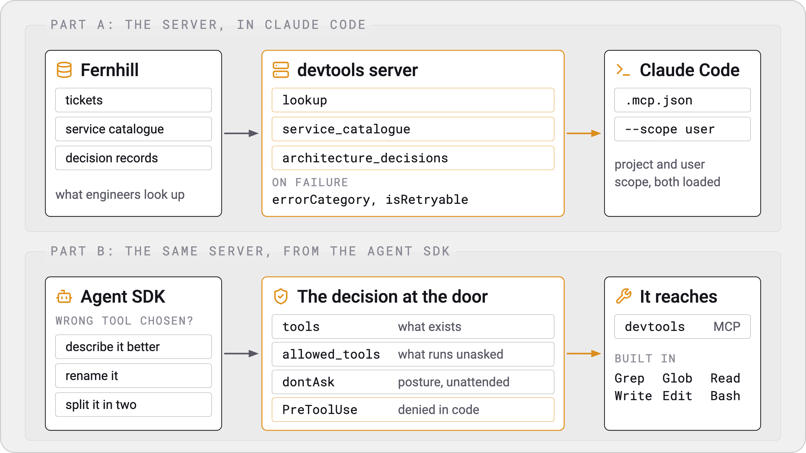
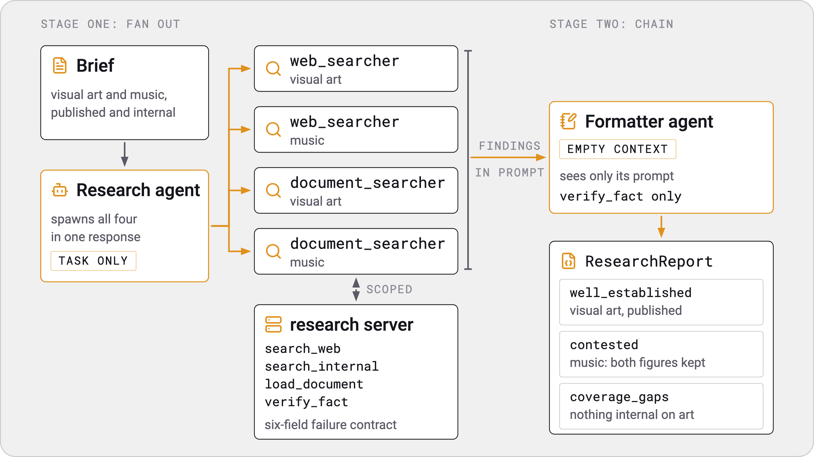
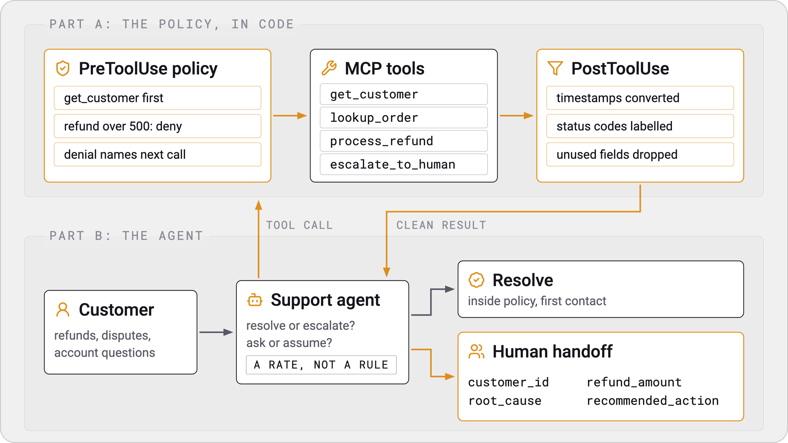
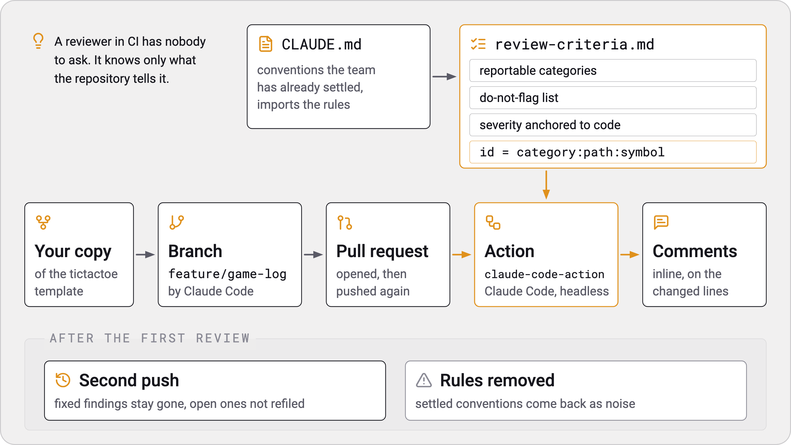
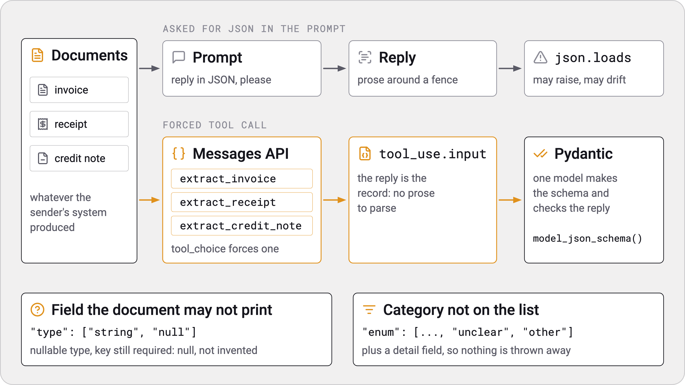
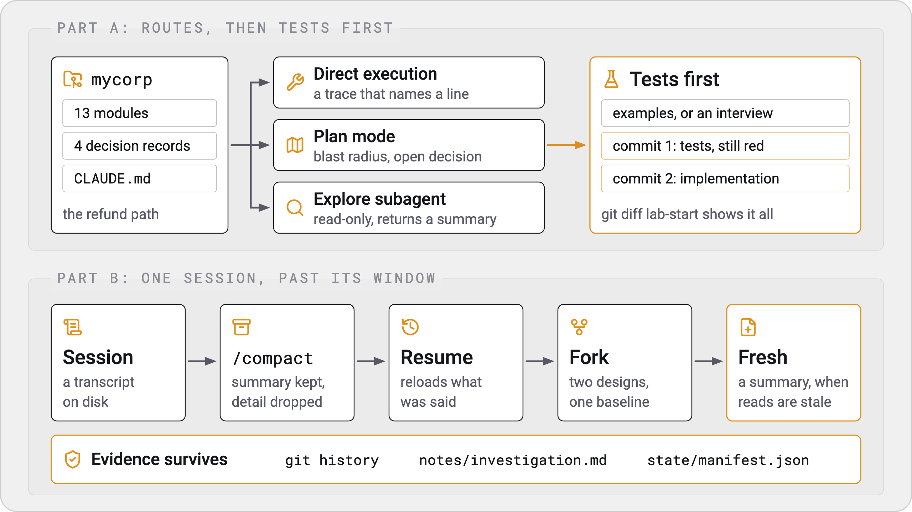

# Labs and code examples

Six guided labs, one per official exam scenario, plus the small refund demo I use for the
Day 1 quick win. They are the same labs as the recorded course: you keep them after the
cohort.

## Which lab goes with which chapter

| Chapter | Demo | Folder | Needs |
|---|---|---|---|
| Day 1, opening: the exam and how to pass it | Prompt vs. hook on a refund | `quickwin/` | subscription or key (`gates` needs nothing) |
| Day 1, Chapters A and B | An agent, a tool and a hook from zero | `quickwin/steps/` | subscription or key |
| Day 1, Chapter B: MCP and the Agent SDK | An identity gate that blocks a refund | `lab_03/` parts A and B, `quickwin/` | nothing for part A |
| Day 1, Chapter E: Agentic Architecture Patterns | Four searchers in one response, then a formatter | `lab_02/` | subscription or key |
| Day 1, Chapter F: Tool Design and MCP Patterns | An MCP server with structured errors | `lab_01/` part A, then part B | nothing for part A |
| Day 2, Chapter G: Claude Code Workflow Patterns | Claude Code reviewing a pull request | `lab_04/` | a GitHub account |
| Day 2, Chapter H: Prompting and Structured Output Patterns | Forced tool-schema extraction | `lab_05/` | an API key |
| Day 2, Chapter I: Context and Reliability Patterns | Compaction, resume and fork in a real project | `lab_06/` parts A and B | Claude Code signed in |

## Set up once

You need Python 3.10 or later, [uv](https://docs.astral.sh/uv/) and
[Claude Code](https://code.claude.com/docs/en/overview).

```bash
cd 01-labs
uv sync
cp .env.example .env     # read the notes at the top of it
uv run jupyter lab
```

On a Claude Pro, Max, Team or Enterprise subscription, leave both credential lines in `.env`
blank and run `claude` once to sign in: the Agent SDK labs then run on your subscription. On
API billing, put a Console key in `ANTHROPIC_API_KEY`. Lab 5 calls the Claude API directly
and needs a key whichever you choose. The first cell of each lab prints which credential it
found.

The quick-win demo is its own small project:

```bash
cd 01-labs/quickwin
uv sync
cp .env.example .env
uv run demo_sdk/run.py gates              # the hooks, called directly, no model
uv run demo_sdk/run.py refund --hooks off # the rule lives only in the prompt
uv run demo_sdk/run.py refund --hooks on  # the same conversation, enforced
```

## What each lab builds

### Lab 1, developer productivity toolset

Part A builds an MCP server with structured errors and wires it into Claude Code, with no
API calls. Part B drives it from the Agent SDK.



### Lab 2, multi-agent research system

A coordinator spawns four channel-partitioned searchers in one response, then chains their
findings into a formatter agent.



### Lab 3, customer support resolution agent

Part A builds the tools and hooks offline. Part B runs the agent: prerequisite gate, refund
limit, normaliser and structured handoff.



### Lab 4, Claude Code for continuous integration

Your own copy of a template repository, a change on a branch, the review action, and the
pull request that triggers it.



### Lab 5, structured extraction pipeline

Tool-schema extraction over short supplier documents: nullable fields, `unclear` and
`other`, and Pydantic validation.



### Lab 6, code generation in a real project

`lab_06/mycorp/` is the project. Everything happens in `claude` in a terminal, using the
prompts the notebooks hold.


