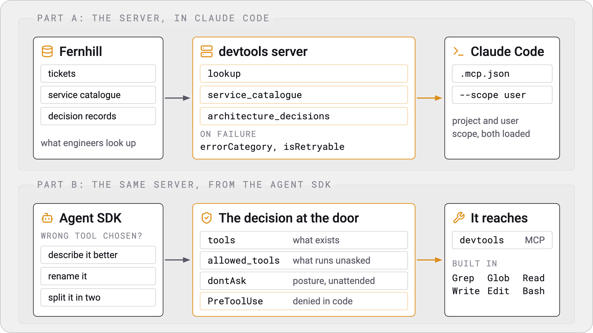
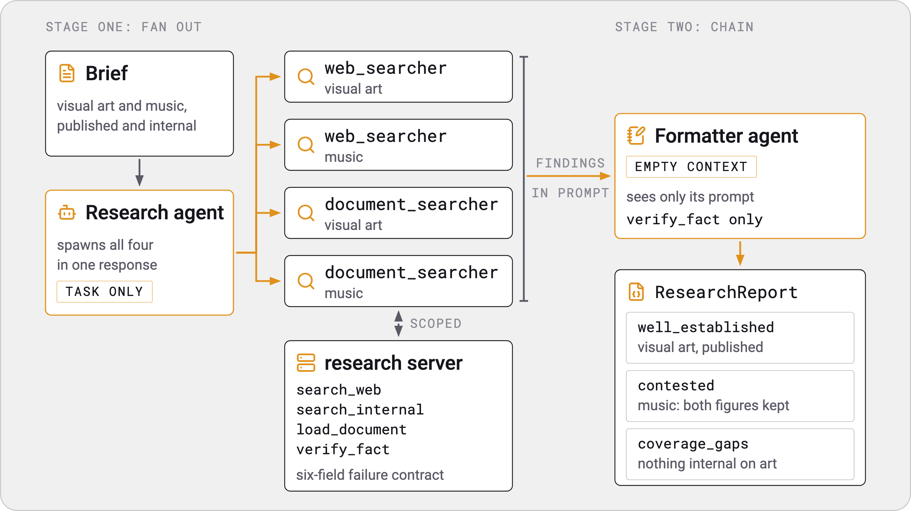
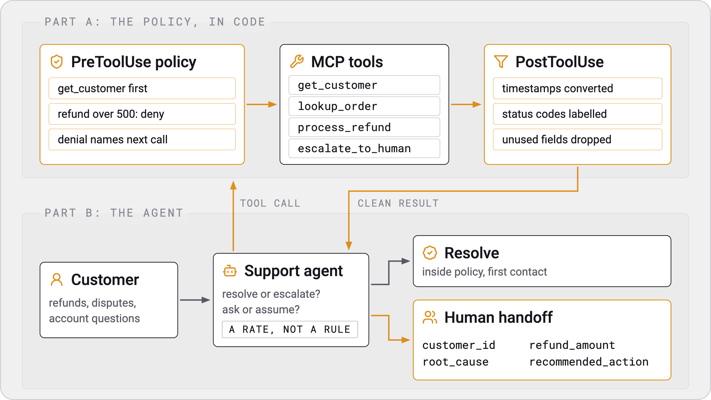
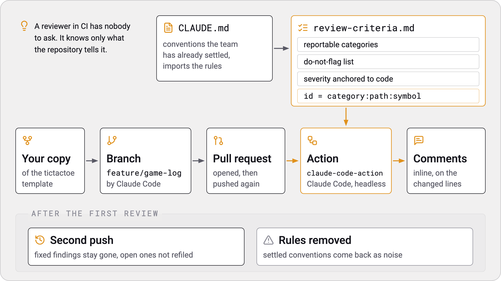
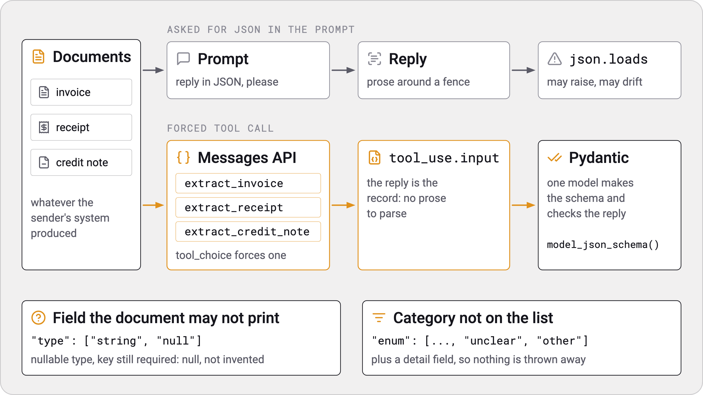
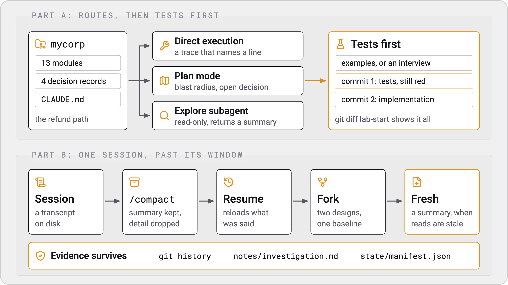

# Claude-Code-Certified-Architect-Foundation-CCAR-F-Certification-Bootcamp
Claude Code Certified Architect Foundation (CCAR-F): Certification Bootcamp event, by Packt

## Contents

| Folder | What |
|---|---|
| [`01-labs/`](01-labs/) | The six guided labs, one per official exam scenario, plus the quick win and the refund demo. Setup, the chapter-to-lab map and the subscription-or-key choice are in "Labs and setup" below and in its README. |
| [`02-skill-coach/`](02-skill-coach/) | `ccarf-coach`, a Claude Code study skill that quizzes you, explains the Claude stack in exam terms, recaps sessions and walks you through the labs. Install steps are in "Study with the coach skill" below and in its README. |

## Labs and setup

Everything you need to get the labs and the coach running, before Day 1. The same guidance
is in `01-labs/README.md`.

### Which lab goes with which chapter

| Chapter | Demo | Folder in `01-labs/` | Needs |
|---|---|---|---|
| Day 1, opening: the exam and how to pass it | An agent with built-in tools writes, tests and plays a greeting animation | `quickwin/greeter/` | subscription or key |
| Day 1, Chapters A and B | An agent, a tool and a hook from zero | `quickwin/steps/` | subscription or key |
| Day 1, Chapter B: MCP and the Agent SDK | An identity gate that blocks a refund | `lab_03/` parts A and B, `quickwin/` | nothing for part A |
| Day 1, Chapter E: Agentic Architecture Patterns | Four searchers in one response, then a formatter | `lab_02/` | subscription or key |
| Day 1, Chapter F: Tool Design and MCP Patterns | An MCP server with structured errors | `lab_01/` part A, then part B | nothing for part A |
| Day 2, Chapter G: Claude Code Workflow Patterns | Claude Code reviewing a pull request | `lab_04/` | a GitHub account |
| Day 2, Chapter H: Prompting and Structured Output Patterns | Forced tool-schema extraction | `lab_05/` | an API key |
| Day 2, Chapter I: Context and Reliability Patterns | Compaction, resume and fork in a real project | `lab_06/` parts A and B | Claude Code signed in |

### Where each lab is

Everything lives in `01-labs/`. There are two small Python projects here, each
with its own `pyproject.toml` and its own environment: the labs at the top, and the quick win
in `quickwin/`.

```
01-labs/
├── pyproject.toml            the lab environment (one for all six labs)
├── .env.example              copy to .env: your credential and the model names
├── lab_01/                   Lab 1, developer productivity toolset
│   ├── lab01_part_a.ipynb      MCP server with structured errors, no API calls
│   └── lab01_part_b.ipynb      the same server driven from the Agent SDK
├── lab_02/
│   └── lab02.ipynb           Lab 2, multi-agent research system
├── lab_03/                   Lab 3, customer support resolution agent
│   ├── lab03_part_a.ipynb      tools and hooks, offline
│   └── lab03_part_b.ipynb      the live agent
├── lab_04/
│   └── lab04_ci_review.ipynb Lab 4, Claude Code in CI (a script you follow in a terminal)
├── lab_05/
│   └── lab05_extraction.ipynb Lab 5, structured extraction pipeline
├── lab_06/                   Lab 6, code generation in a real project
│   ├── lab06_part_a.ipynb      routes, plan mode, tests first
│   ├── lab06_part_b.ipynb      compaction, resume, fork
│   └── mycorp/                 the project Claude Code works on
└── quickwin/                 its own project: pyproject.toml and .env.example
    ├── greeter/                the Day 1 quick win
    ├── steps/                  an agent, a tool and a hook, in three files
    ├── demo_sdk/               the refund demo on the Agent SDK
    └── demo_claude_code/       the same rules as Claude Code hooks
```

### Get started

Do this before Day 1. It takes about fifteen minutes, most of it downloads.

#### 1. Install VS Code

VS Code is the editor used throughout the cohort: it opens the notebooks, runs the terminal
for Labs 4 and 6, and hosts Claude Code in a side panel. Download it for macOS, Windows or
Linux from [code.visualstudio.com/download](https://code.visualstudio.com/download) and
install it like any other application.

#### 2. Add the VS Code extensions

Open the Extensions view (`Cmd+Shift+X` on macOS, `Ctrl+Shift+X` on Windows and Linux),
search for each of these by name and press **Install**:

| Extension | Publisher | Why you need it |
|---|---|---|
| **Python** | Microsoft (`ms-python.python`) | Finds the `.venv` that uv creates and offers it as the interpreter. It installs Pylance with it. |
| **Jupyter** | Microsoft (`ms-toolsai.jupyter`) | Opens and runs the `.ipynb` notebooks inside VS Code. |
| **Claude Code for VS Code** | Anthropic (`anthropic.claude-code`) | Claude Code in a side panel, with diffs shown in the editor. Optional: every lab also works with `claude` in the terminal. |

If you prefer the command line, the same three in one go:

```bash
code --install-extension ms-python.python --install-extension ms-toolsai.jupyter --install-extension anthropic.claude-code
```

(`code` is on your PATH after you run **Shell Command: Install 'code' command in PATH** from
the Command Palette on macOS. The Windows installer adds it for you.)

#### 3. Install uv

[uv](https://docs.astral.sh/uv/) installs Python itself, creates the environment and installs
every package the labs need, pinned by `uv.lock`, in one command. You do not need to install
Python separately: if Python 3.10 or later is missing, uv downloads one.

On macOS or Linux:

```bash
curl -LsSf https://astral.sh/uv/install.sh | sh
```

On macOS with Homebrew, this works as well:

```bash
brew install uv
```

On Windows, in PowerShell:

```powershell
powershell -ExecutionPolicy ByPass -c "irm https://astral.sh/uv/install.ps1 | iex"
```

Open a new terminal afterwards so the `uv` command is found, and check it with `uv --version`.
The [uv installation guide](https://docs.astral.sh/uv/getting-started/installation/) covers
other options.

#### 4. Install Claude Code, and git

Labs 1, 2, 3 and the quick win use the Agent SDK, which runs the `claude` binary under the
hood. Labs 4 and 6 are done in `claude` directly. Install it with the instructions on
[code.claude.com/docs/en/overview](https://code.claude.com/docs/en/overview), then run `claude`
once in a terminal to sign in (or to confirm it starts, if you will use an API key).

Lab 4 also needs [git](https://git-scm.com/downloads), the
[GitHub CLI](https://cli.github.com/) (`gh`, signed in with `gh auth login`) and a GitHub
account. Lab 6 needs git.

#### 5. Initialise the lab environment with uv

In VS Code, choose **File > Open Folder...** and open your clone of this repository, the folder
that contains `01-labs/` and `02-skill-coach/`. If you have not cloned it yet, do that first:

```bash
git clone https://github.com/PacktPublishing/Claude-Code-Certified-Architect-Foundation-CCAR-F-Certification-Bootcamp
```

Keeping the whole repository open lets you run the notebooks and the coach skill from the
same window. Then open a terminal with
**Terminal > New Terminal** and run:

```bash
cd 01-labs
uv sync
```

`uv sync` reads `pyproject.toml` and `uv.lock`, creates `.venv/` in `01-labs/` and installs
the Agent SDK, the Anthropic SDK, the MCP SDK, Pydantic, JupyterLab and the rest into it. Run
it again whenever the lock file changes; it only installs what is missing. You never need to
activate the environment: `uv run <command>` runs anything inside it.

Then create your settings file and choose how you sign in ("Subscription or API key" below explains
the choice):

```bash
cp .env.example .env
```

On Windows PowerShell, use `Copy-Item .env.example .env`.

The quick win is a separate, smaller project with its own environment. Set it up the same way
when you get to it:

```bash
cd quickwin
uv sync
cp .env.example .env
```

The quick win and the refund demo are scripts, not notebooks. Run them from `01-labs/quickwin`:

```bash
uv run greeter/run.py                     # the quick win: an agent builds a greeting animation
python3 greeter/out/greet.py              # play the last result again
uv run steps/01_simple_agent.py           # an agent, then a tool (02_), then a hook (03_)
uv run demo_sdk/run.py gates              # the hooks, called directly, no model
uv run demo_sdk/run.py refund --hooks off # the rule lives only in the prompt
uv run demo_sdk/run.py refund --hooks on  # the same conversation, enforced
```

#### 6. Open a notebook

**In VS Code.** Open a notebook such as `01-labs/lab_01/lab01_part_a.ipynb`. Press
**Select Kernel** at the top right, choose **Python Environments**, and pick the one whose
path ends in `01-labs/.venv`. VS Code remembers the choice per notebook. If it is not in the
list, choose **Enter interpreter path...** and give `01-labs/.venv/bin/python` (on Windows,
`01-labs\.venv\Scripts\python.exe`). If VS Code offers to install `ipykernel`, you can
decline: `uv sync` already installed it.

**In JupyterLab.** If you prefer the browser, run this from `01-labs` and open the notebook
from the file browser on the left:

```bash
uv run jupyter lab
```

Either way, run the notebook from its own folder: the cells find `pyproject.toml` and
`.env` relative to the notebook's location. The first cell of each lab prints which
credential it found.

### Subscription or API key

You can do almost everything on a Claude subscription. Only Lab 5 needs an API key.

#### How it works

The Agent SDK does not call the Claude API itself. It starts the `claude` binary (Claude
Code) as a subprocess and talks to it, so it signs in exactly the way `claude` does in your
terminal. That gives you three ways in, and `claude` checks them in this order:

1. **`ANTHROPIC_API_KEY`**, a key from the [Claude Console](https://console.anthropic.com/).
   Every call is billed to your Console account per token. If this variable is set, it wins
   over everything else.
2. **`CLAUDE_CODE_OAUTH_TOKEN`**, a long-lived token tied to your subscription, printed by
   `claude setup-token`. Useful on a machine you would rather not sign in on, and the
   credential Lab 4 hands to GitHub.
3. **Your subscription login**, stored when you run `claude` once and sign in with a Claude
   Pro, Max, Team or Enterprise account. Calls count against your plan's usage limits
   rather than producing a bill.

The labs load `.env` into the environment before they start the SDK, so whatever you put in
`.env` is what `claude` sees.

Lab 5 is the exception because it uses the Anthropic Python SDK (`anthropic`) to call the
Messages API directly, with no `claude` binary in between. The API accepts only Console API
keys, so a subscription cannot pay for it.

#### Choosing

**On a Claude subscription** (the cheapest route if you already have one): leave both
credential lines in `.env` blank, run `claude` once and sign in. Labs 1, 2, 3 and 6 and the
quick win then run on your plan. For Lab 5, add an API key to `.env` for that lab only, then
blank it again afterwards, because a key set in `.env` outranks your login for every other
lab too.

**On API billing:** put a Console key in `ANTHROPIC_API_KEY` in `.env`, and every lab
uses it. Each lab costs from a few cents to about thirty cents; the budget is printed at the
top of each notebook.

**Mixing them by accident** is the usual surprise: a key left in `.env`, or an
`ANTHROPIC_API_KEY` exported in your shell profile, silently overrides your subscription
login and starts billing the Console. If a lab reports a key you did not mean to use, check
both places. The first cell of each lab prints which credential it found.

#### Which labs need what

| Lab | Subscription | API key | Notes |
|---|---|---|---|
| Quick win, `quickwin/` | yes | yes | `DEMO_MODEL=haiku` keeps it to cents on a key |
| Lab 1 part A, Lab 3 part A | not needed | not needed | offline, no model calls |
| Lab 1 part B, Lab 2, Lab 3 part B | yes | yes | Agent SDK |
| Lab 4 | yes, via `claude setup-token` as the `CLAUDE_CODE_OAUTH_TOKEN` secret | yes, as the `ANTHROPIC_API_KEY` secret | the credential is stored on GitHub, not in `.env` |
| Lab 5 | no | **required** | calls the Messages API directly |
| Lab 6 | yes | yes | `claude` in a terminal, signed in either way |

### Study with the coach skill

`ccarf-coach`, in `02-skill-coach/`, is a Claude Code skill: a study coach that quizzes you
on the exam domains, explains any part of the Claude stack in exam terms, recaps a cohort
chapter, reads your practice exam result, and walks you through these labs one step at a
time. A skill is a folder with a `SKILL.md` that Claude Code reads when your request matches
its description, so there is nothing to call by name: you ask, and the coach takes over.

#### Install it

From the root of this repository (the folder that contains `01-labs/`), copy the skill into the
project's skills folder and start Claude Code there:

```bash
mkdir -p .claude/skills
cp -r 02-skill-coach/ccarf-coach .claude/skills/
claude
```

Start `claude` from the repository root rather than from `01-labs/`: the coach gives lab paths
from the root, and it asks where the labs are if it cannot see `01-labs/`. In VS Code, the
Claude Code panel uses the folder you opened, so open the repository root as in step 5 above.

To have the coach in every project on your machine instead, copy it to your personal skills
folder:

```bash
mkdir -p ~/.claude/skills
cp -r 02-skill-coach/ccarf-coach ~/.claude/skills/
```

Check that it loaded by asking Claude Code "quiz me on domain 2". The coach runs on whatever Claude Code is signed in with,
subscription or key, like any other Claude Code session.

#### What to ask it

| You say | It does |
|---|---|
| "Quiz me on domain 4", "a question on task 1.3", "quiz me on Chapter E" | One exam-style item with the answer hidden until you reply, then the evidence, why the answer wins, why each distractor fails, the chapter to revisit and a running score |
| "Explain PreToolUse for the exam", "tool use vs MCP" | The decision the exam tests, how the mechanism works, the classic distractor, the lab that shows it and the official docs |
| "Recap Chapter H" | The chapter's decisions as short rules, its slides and lab, then two quiz items |
| "Here is my practice exam result" (paste the text from **Copy result summary**) | Your weak domains ordered by exam weight, the chapters and labs for each missed task, and a revision plan |
| "Walk me through Lab 3", "run the quick win", "which lab shows subagents" | The lab step by step: what to watch for before each command and what the result showed afterwards |

The coach never reproduces items from the practice exam, the clinic, the homework or the
simulated exam, so practising with it does not spoil your own attempt at those.

A good rhythm during the cohort: after each chapter, ask for a recap and two quiz items; when
a lab step is unclear, ask the coach to walk you through it; after the practice exam, paste
your result and follow the revision plan it gives you. More detail is in
`02-skill-coach/README.md`.

### What each lab builds

- **Quick win, an agent with built-in tools.** No custom tools and no MCP server: Read,
  Write, Edit, Glob and Bash, with Bash allowed to run `python3` and nothing else. The agent
  writes `greet.py`, an animated ASCII greeting, tests it, and the script plays it. About a
  minute and a few tens of cents with `DEMO_MODEL=haiku`.

#### Lab 1, developer productivity toolset

Part A builds an MCP server with structured errors and wires it into Claude Code, with no
API calls. Part B drives it from the Agent SDK.



#### Lab 2, multi-agent research system

A coordinator spawns four channel-partitioned searchers in one response, then chains their
findings into a formatter agent.



#### Lab 3, customer support resolution agent

Part A builds the tools and hooks offline. Part B runs the agent: prerequisite gate, refund
limit, normaliser and structured handoff.



#### Lab 4, Claude Code for continuous integration

Your own copy of a template repository, a change on a branch, the review action, and the
pull request that triggers it.



#### Lab 5, structured extraction pipeline

Tool-schema extraction over short supplier documents: nullable fields, `unclear` and
`other`, and Pydantic validation.



#### Lab 6, code generation in a real project

`01-labs/lab_06/mycorp/` is the project. Everything happens in `claude` in a terminal, using the
prompts the notebooks hold.


